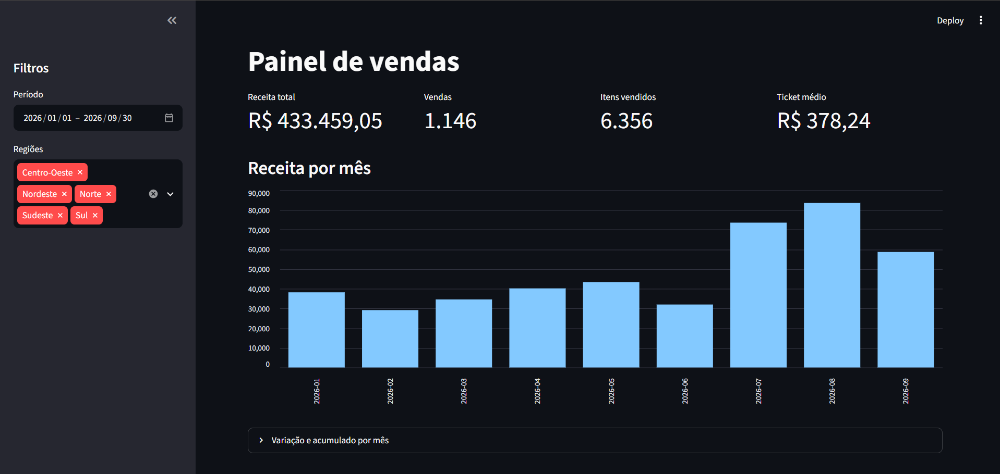

# Dashboard de Vendas | Pipeline ETL e PostgreSQL

Pipeline de dados desenvolvido em Python para consolidar vendas de diferentes fontes, armazenar informações em PostgreSQL e disponibilizar indicadores em um painel interativo.

## Demonstração



## Sobre o projeto

Empresas podem receber dados de vendas em diferentes arquivos e planilhas, com formatos inconsistentes e registros duplicados.

Este projeto automatiza esse processo: extrai os dados, padroniza as informações, valida os registros, armazena os resultados em um banco de dados e apresenta indicadores para análise.

## Funcionalidades

- Extração de dados de múltiplos arquivos CSV e planilha online.
- Padronização e limpeza dos dados com Python e pandas.
- Armazenamento estruturado em PostgreSQL.
- Prevenção de registros duplicados (carga idempotente).
- Transações com rollback em caso de falha.
- Registro do histórico de execuções e cargas.
- Consultas SQL para análise de vendas.
- Dashboard interativo com filtros e indicadores.
- Execução dos serviços com Docker Compose.
- Testes automatizados e integração contínua com GitHub Actions.

## Tecnologias

| Tecnologia | Aplicação |
|---|---|
| Python | Processamento e integração dos dados |
| pandas | Manipulação e limpeza |
| PostgreSQL | Banco de dados relacional |
| SQL | Consultas e indicadores |
| Streamlit | Interface do dashboard |
| Docker | Containerização |
| Docker Compose | Orquestração dos serviços |
| pytest | Testes automatizados |
| GitHub Actions | Integração contínua |


## Indicadores disponíveis

O dashboard apresenta:

- Receita total.
- Quantidade de vendas.
- Total de itens vendidos.
- Ticket médio.
- Receita por mês.
- Produtos e categorias com maior receita.
- Ranking de vendedores por região.
- Histórico e qualidade das cargas.

Também permite filtrar os resultados por período e região.

## Como executar

### Pré-requisitos

- Docker Desktop.
- Docker Compose.
- Git.

### 1. Clone o repositório

```bash
git clone https://github.com/gasgabriel/dashboard-vendas.git
cd dashboard-vendas
```

### 2. Configure as variáveis de ambiente

```bash
cp .env.example .env
```

No PowerShell do Windows:

```powershell
Copy-Item .env.example .env
```

A URL da planilha é opcional. Consulte o arquivo `.env.example`.

### 3. Inicie a aplicação

```bash
docker compose up --build
```

### 4. Acesse o dashboard

Abra no navegador:

```text
http://localhost:8501
```

Para acompanhar o processamento:

```bash
docker compose logs -f etl
```

Para encerrar:

```bash
docker compose down
```

## Banco de dados

O PostgreSQL utiliza quatro tabelas principais:

| Tabela | Finalidade |
|---|---|
| `produtos` | Cadastro de produtos e categorias |
| `vendas` | Armazenamento das vendas |
| `execucoes` | Histórico das execuções do pipeline |
| `cargas` | Resultado do processamento por fonte |

O banco possui restrições de integridade, chaves estrangeiras e controle de duplicidade.

## Testes

Para executar os testes:

```bash
python -m pytest -q
```

Os testes contemplam extração, limpeza, persistência, consultas, idempotência, tratamento de falhas e funcionamento do painel.

A integração contínua utiliza GitHub Actions para executar os testes automaticamente.

## Decisões técnicas e limitações

- A identificação das vendas utiliza uma chave baseada nos dados normalizados.
- A carga utiliza transações para evitar persistência parcial.
- A receita é calculada pelo próprio PostgreSQL.
- O agendamento atual utiliza um intervalo simples de execução.
- A planilha é consultada por URL pública; integrações reais podem exigir autenticação e uso da API do Google.

Os dados utilizados no projeto são fictícios.

## Próximas melhorias

- Integração autenticada com Google Sheets API.
- Agendamento com ferramenta dedicada.
- Monitoramento e logs estruturados.
- Deploy em ambiente de nuvem.
- Autenticação e controle de acesso ao dashboard.

## Autoria

Desenvolvido por gasgabriel e taleticia como projeto de portfólio para demonstrar conhecimentos em Engenharia de Dados, automação de processos, bancos de dados e visualização de informações.